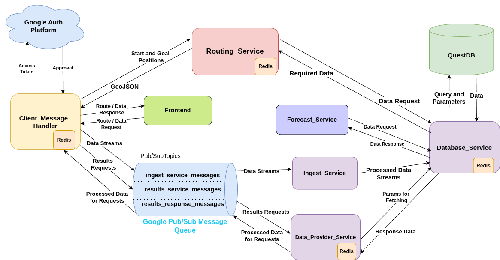

# CityAirQ

Backend infrastructure for air quality monitoring in Bucharest.



## Contributors

* [Filip Dumitrascu](https://github.com/filipdumitrascu)
* [Bianca Dumitru](https://github.com/dbianca0907)

## Quick Start

### Configuration

Make scripts executable:
```bash
chmod +x scripts/*.sh
```

### Local Development (Docker)

Start all services locally:
```bash
./scripts/local/run.sh
```

Stop services:
```bash
./scripts/local/stop.sh -n
```

Clean up:
```bash
./scripts/local/stop.sh -y
```

### Production Deployment (Kubernetes)

See [README.md](scripts/cloud/README.md) for detailed deployment instructions.

### Monitoring (after Kubernetes)

Only first time:
```bash
./scirpts/monitoring/setup.sh
```

Optional:
```bash
./scripts/monitoring/loadtest.sh
```

Before deleting cluster:
```bash
./scripts/monitoring/cleanup.sh
./scirpts/cloud/clean.sh
``` 


## Architecture

- **Microservices**: FastAPI-based services for data ingestion, processing, and routing
- **Message Queue**: Google Pub/Sub for async communication
- **Database**: QuestDB for time-series data
- **Cache**: Redis for route caching
- **Orchestration**: Kubernetes (GKE)
- **Monitoring**: Prometheus + Grafana + Loki

## Services

- `client-message-handler`: Public API endpoint (port 8000)
- `database-service`: Database interface (port 8002)
- `ingest-service`: Data ingestion
- `data-provider-service`: Data retrieval (port 8001)
- `routing-service`: A* pathfinding for least polluted routes (port 8003)
- `redis`: Cache layer (port 6379)

## External IPs

- `frontend` : http://35.188.2.234
- `grafana` : http://35.192.10.90:80
(username: admin  password: cityairq-admin)
